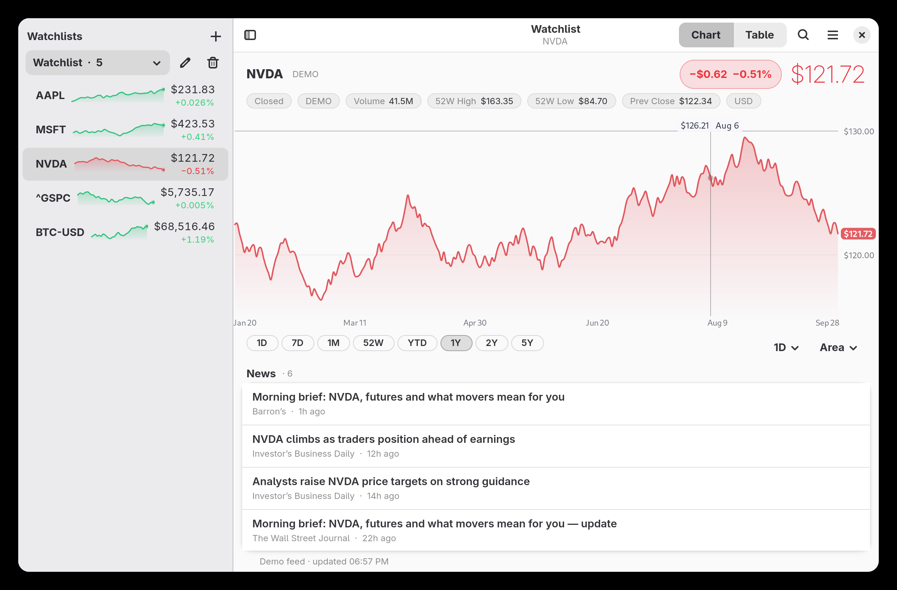

# TickerGlass — a stock ticker for your GNOME panel (and a desk for your desk)

A tiny window onto the market. An animated sparkline of your hero symbol
lives in the panel; clicking it opens a card with a big live price, a
draw-in chart, range tabs and a per-symbol mini-sparkline list. A companion
GTK 4 app shares the same settings, watchlists and chart engine — move a
watchlist in one, the other follows instantly.

- **Any Yahoo symbol**: stocks, ETFs, indices (`^GSPC`), FX (`EURUSD=X`),
  crypto (`BTC-USD`), futures (`GC=F`) — search-add from both app and card
- **Two-pane app**: a watchlist dropdown and live sparkline rows on the
  left; click a symbol for the full history view on the right
  (or flip to the sortable table view)
- **Charts that flex**: 1D · 7D · 1M · 52W · YTD · 1Y · 2Y · 5Y ranges with
  interval picker and area / line / candle styles, hover crosshair,
  price axis, prev-close line
- **News**: recent Yahoo Finance stories for the selected symbol, one
  click to open in your browser
- **Watchlists & columns**: unlimited named lists, 11 table columns you can
  show/hide and sort by (click the headers in the table view)
- **Live sync**: one gsettings schema (`org.gnome.shell.extensions.tickerglass`)
  drives both the extension and the app; changes apply while open
- **Two data sources**: Yahoo Finance (keyless endpoints, host rotation and
  backoff built in) and a deterministic **demo** feed for offline use and
  for the test harness — switchable in prefs or via gsettings
- Panel modes: sparkline / ticker / price; market-hours-aware refresh;
  HiDPI-aware cairo painting (~20 fps, pauses when the menu is closed)
- GNOME Shell **50** (ES modules), GTK 4 + libadwaita app under plain `gjs`



## Install

```sh
./install.sh
```

That installs the shared gsettings schema, the shell extension, and the app
(to `~/.local/share/tickerglass` plus a `.desktop` entry). Then:

- **Extension**: log out and back in (GNOME 50 only scans
  `~/.local/share/gnome-shell/extensions` at login), then enable it in the
  Extensions app. A sparkline appears in the panel; ⚙ in its menu opens
  preferences.
- **App**: launch "TickerGlass" from the app grid, or run
  `gjs -m ~/.local/share/tickerglass/main.js`.

## Uninstall

```sh
gnome-extensions disable tickerglass@vijaybala.dev
rm -rf ~/.local/share/gnome-shell/extensions/tickerglass@vijaybala.dev
rm -rf ~/.local/share/tickerglass
rm -f ~/.local/share/applications/dev.vijaybala.TickerGlass.desktop
```

## Data sources

Four settings for `data-source`:

- **`yahoo`** — talks to Yahoo's keyless `query*.finance.yahoo.com`
  endpoints directly. No API key, but these endpoints rate-limit hard by
  IP (HTTP 429), and CGNAT / shared-pool egress is often throttled
  preemptively. The client rotates hosts, bootstraps a cookie+crumb pair
  and backs off exponentially.
- **`yahoo-relay`** — the same requests, routed through a public fetch
  relay (`r.jina.ai`) whose egress IP Yahoo trusts. One hop slower per
  request (a few seconds) but works from networks Yahoo won't serve at
  all — pick this from the menu / Preferences if plain Yahoo only ever
  says "Rate limited".
- **`nasdaq`** — Nasdaq's keyless site API (`api.nasdaq.com`): live
  quotes and full daily history for US-listed stocks and ETFs on any
  exchange, answered instantly even by networks Yahoo blanket-blocks.
  It has no crypto, indices or news — those symbols (e.g. `BTC-USD`)
  and the news feed are transparently resolved through the relay.
- **`demo`** — a deterministic pseudo-market that paints the same UI
  offline; every chart ends exactly at the quote price, so screenshots
  and tests stay honest:

```sh
gsettings set org.gnome.shell.extensions.tickerglass data-source yahoo-relay
```

## Layout

| file | role |
|---|---|
| `shared/fmt.js` | formatters, range/interval rules, watchlist JSON, PRNG |
| `shared/yahoo.js` | `MarketClient` facade + Yahoo client (rotation, backoff, crumb) |
| `shared/mock.js` | the demo feed — same shape as the Yahoo client |
| `shared/spark.js` | pure cairo painters (panel sparkline, card chart, text) |
| `shared/prompt.js` | one-line text prompt on `Adw.Dialog` (no `Adw.EntryDialog`) |
| `extension/extension.js` | panel button, sparkline frame driver, timers |
| `extension/menu.js` | the dropdown card (hero, chart, ranges, rows) |
| `extension/prefs.js` | Adw preferences window (watchlist editor included) |
| `app/main.js` | `Adw.Application` launcher |
| `app/window.js` | the whole window: watchlist dropdown + sparkline rows, hero, chart, news, table view, dialogs |
| `schemas/…gschema.xml` | the settings contract both halves share |
| `tools/build.sh` | assembles `dist/extension` + `dist/app` (copies `shared/`) |
| `tools/preview.mjs` | renders every painter to PNG outside the shell |
| `tools/shellcheck.sh` | boots a nested headless shell and asserts the card paints |

## Editing the code? Restart the shell session

GNOME Shell 50 caches an extension's ES modules inside the long-lived
`gnome-shell` process, and there is no `ReloadCode` anymore — so after
editing `extension/*.js` or `shared/*.js` you must log out and back in (or
test instantly with `./tools/shellcheck.sh`, which boots a throwaway nested
shell against a copy of the extension). The app is simpler: rebuild
(`tools/build.sh`), copy `dist/app/*` over `~/.local/share/tickerglass/`,
relaunch.

## Development checks

```sh
gjs -m tools/syntax-check.mjs    # parse every module under gjs
gjs -m tools/imports-check.mjs   # verify imports resolve + schema keys line up
gjs -m tools/preview.mjs         # painter regression PNGs → /tmp/tickerglass-preview
./tools/shellcheck.sh            # nested-shell boot + paint assertions
```

## License

GPL-3.0-or-later — see `LICENSE`. Every source file carries the
matching SPDX notice.

**Data disclaimer:** the market data this app reads comes from
*unofficial*, undocumented web endpoints of Yahoo Finance and Nasdaq —
no endorsement or affiliation with either, and no redistribution
rights in the data itself. The GPL covers the code, not the feed:
use it as a personal ticker, not as a data pipeline others depend on.
